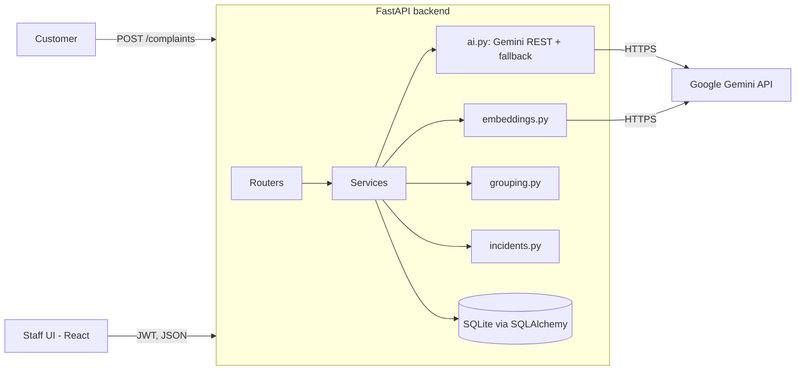

# Design

## Architecture overview

Flow of one complaint: validate and rate-limit, analyse (Gemini, schema-validated, fallback on failure), embed, run the grouping rule, store, return. Incident summaries are generated when an incident is created or its membership changes. Humans approve, reject, investigate and resolve.

Frontend: React + Vite + Tailwind + Recharts on Vercel. Backend: FastAPI on Render. Database: SQLite file seeded on startup (free hosts have ephemeral disks; all demo data is synthetic and re-seeded).

## Components

| Component | Responsibility | Technology |
|-----------|----------------|------------|
| Routers (`auth`, `complaints`, `incidents`, `dashboard`) | HTTP only: validation, auth, status codes | FastAPI, Pydantic v2 |
| `services/ai.py` | Gemini calls with JSON schema output, timeout, retry with backoff, circuit breaker, validation | httpx, Pydantic |
| `services/fallback.py` | Deterministic offline analysis (keyword and lexicon), templated summaries | Python, scikit-learn TF-IDF |
| `services/embeddings.py` | Embeddings via Gemini embedding API (768 dims), cache by text hash, TF-IDF fallback vectors | httpx, numpy |
| `services/grouping.py` | The stable grouping rule (below) | numpy, scikit-learn cosine |
| `services/incidents.py` | Incident lifecycle, atomic resolve, history, citation validation | SQLAlchemy |
| `security.py` | bcrypt hashing, JWT (HS256), role dependency, in-memory rate limiter | bcrypt, PyJWT |
| Frontend | Submit page, dashboard, complaints, incidents, incident detail | React, Tailwind, Recharts |

## Data model

| Table | Key columns |
|-------|-------------|
| `users` | id, username (unique), password_hash, role |
| `complaints` | id, customer_name, customer_contact, text, text_hash, category, sentiment, urgency, symptoms (JSON), affected_service, analysis_source, embedding (JSON), status, incident_id (FK, nullable), created_at |
| `incidents` | id, title, affected_service, status, priority, assigned_team, summary, summary_stale, shared_symptoms (JSON), hypotheses (JSON), suggested_actions (JSON), created_at, updated_at, resolved_at |
| `incident_evidence` | id, incident_id, complaint_a, complaint_b, similarity, reason |
| `incident_events` | id, incident_id, from_status, to_status, actor, note, at (append-only status history) |
| `complaint_events` | id, complaint_id, action (assigned, resolved, reopened), actor, note, at (append-only history for standalone complaints) |
| `membership_log` | id, complaint_id, incident_id, action (attached, detached, recurrence_flagged, folded_in), score, actor, at (append-only; proves membership never changes silently) |
| `pair_blocks` | complaint_a, complaint_b (pairs a human rejected; never re-suggested) |

No hard deletes anywhere; there are no delete endpoints. Foreign keys are enforced (`PRAGMA foreign_keys=ON`).

## API / interfaces

Request and response shapes are in `docs/frontend-spec.md` (the contract shared with the frontend).

| Method | Endpoint / interface | Purpose | Auth required |
|--------|----------------------|---------|---------------|
| GET | /api/health | Liveness | No |
| POST | /api/auth/login | Staff login, returns JWT | No (rate limited) |
| GET | /api/auth/me | Current user | Yes |
| POST | /api/complaints | Submit and analyse complaint | No (rate limited) |
| POST | /api/complaints/import | CSV import | Yes |
| GET | /api/complaints, /api/complaints/{id} | List, detail | Yes |
| GET | /api/incidents, /api/incidents/{id} | List, detail | Yes |
| POST | /api/incidents/{id}/approve, /reject, /resolve, /reopen | Lifecycle actions | Yes |
| PATCH | /api/incidents/{id} | Priority, team, mark investigating | Yes |
| POST | /api/complaints/{id}/assign, /resolve, /reopen | Handle a standalone complaint (not in any incident) | Yes |
| GET | /api/dashboard/stats | Dashboard data | Yes |
| GET | /api/incidents/graph | Correlation view (stretch) | Yes |

## Grouping rule (stable, documented)

Constants (in config, tuned on the labelled set): `T_candidate` = 0.62, `T_attach` and `T_pool` decided by the verifier, `MIN_GROUP` = 3.

For each new complaint `c`, in arrival order, exactly once:
1. **Candidate search.** Compute cosine similarity of `c` to each non-rejected incident (average linkage: mean cosine to its member complaints) and to every unassigned complaint. Pairs in `pair_blocks` are excluded.
2. **Verification.** For the best candidate incident and the top 5 unassigned candidates above `T_candidate`, a verifier decides "same underlying cause?" with a one-sentence reason. Gemini does this (JSON, validated). The fallback verifier requires same category, same affected service and symptom overlap, plus a higher cosine threshold. Same category alone is never enough (near-miss rule).
3. **Attach.** If the best incident is verified, `c` is attached. If that incident is `suggested`, `open` or `investigating`, membership grows and a `membership_log` row is written. If it is `resolved`, `c` becomes `possible_recurrence` on that incident (no silent reopening).
4. **New incident.** Otherwise, if at least `MIN_GROUP - 1` unassigned complaints are verified as related to `c`, a new `suggested` incident is created from `c` and those complaints.
5. **Otherwise** `c` stays `new` (a one-off) and waits in the pool.

Guarantees: existing members never move except by an explicit human action (reject, reopen) which is logged. New incidents form only from unassigned complaints, so no duplicate incidents. Order dependence is limited to borderline pairs, which are decided at arrival time and then frozen; the clear-cut labelled set gives identical partitions for any arrival order (tested by shuffling).

## Key decisions and tradeoffs

| Decision | Options considered | Chosen | Why | Tradeoff accepted |
|----------|--------------------|--------|-----|-------------------|
| Embeddings | Local sentence-transformers, Gemini embedding API, TF-IDF only | Gemini embedding API, TF-IDF fallback | PyTorch exceeds free-host RAM; multilingual quality verified on Roman Urdu and Urdu | Network and quota dependency, mitigated by cache and fallback |
| Similarity alone vs verifier | Threshold only; threshold plus LLM check | Threshold to find candidates, verifier to decide | In a quick embedding test, a complaint about the same fault in different words scored only 0.60 against the original, while a translation scored 0.76 to 0.81, so cosine alone is not a reliable same-cause signal | One extra AI call for borderline cases |
| Clustering | Batch DBSCAN/agglomerative; incremental assignment | Incremental, average linkage | Stable memberships, no silent regrouping, explainable | Less globally optimal than batch clustering |
| Database | PostgreSQL, SQLite | SQLite | Zero setup in 6 hours | Ephemeral disk on free hosts, so demo data is re-seeded |
| Gemini client | Official SDK, REST via httpx | REST via httpx | Smaller dependency, full control of retries and schema | Slightly more code |
| Auth | Full registration, seeded accounts | Seeded accounts and JWT | Meets "minimal access control", least risk | No self-service accounts |
| Rate limiting | Redis, in-memory | In-memory sliding window | Single instance demo | Resets on restart, not multi-instance safe |

## AI components

- **Analysis** (per complaint): returns category, sentiment, urgency, symptoms, affected_service. Output must pass Pydantic validation (enums, lengths). Invalid or failed: one retry with backoff, then the deterministic fallback; `analysis_source = fallback` is stored and shown.
- **Verification** (borderline pairs): same-cause decision with reason; failure falls back to the deterministic verifier.
- **Summary and hypotheses** (per incident): summary, shared symptoms, hypotheses, suggested actions. Every cited complaint id is checked server-side to exist and belong to the incident; invalid ids are stripped, and hypotheses left with no valid citation are dropped. Failure uses a templated summary built from stored symptoms.
- Resilience: timeout 15 s, up to 3 attempts with exponential backoff and jitter on 429/5xx, a circuit breaker (3 consecutive failures disables AI for 60 s), a concurrency limit, embedding cache by text hash.
- Complaint text is untrusted: it is wrapped in delimiters, the system prompt says to ignore instructions inside it, output is schema-validated, and AI output never triggers an action by itself. A human approves incidents.

## Security and privacy

### Threat model

Public intake can be spammed (rate limit, size limits); prompt injection through complaint text (delimiters, schema validation, no tool use, human approval); unauthorised state changes (JWT on every mutating route, role checks); brute-force login (rate limit, bcrypt); data loss (no hard deletes, append-only history, transactions); secret leakage (env vars only, `.gitignore`, secret grep before push); XSS (frontend renders text as plain text); CORS (explicit origins from env); error leakage (generic error bodies, details only in server logs).

### Data handled

Synthetic customer names and contact strings only. No real personal data. Passwords bcrypt-hashed. The Gemini key lives only in the backend environment.

### Known limits

In-memory rate limiting resets on restart. SQLite on a free host can lose data on restart, so seed data is recreated at startup. Similarity thresholds are tuned on a small synthetic set. Free-tier AI quota can degrade the app to fallback mode.
